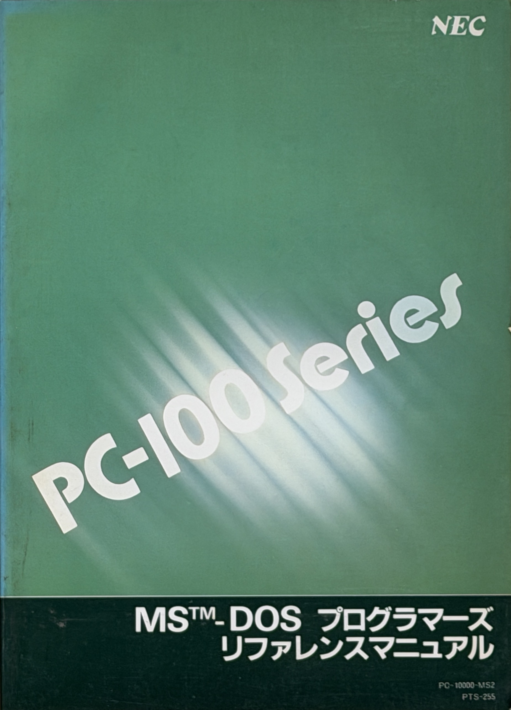

# PC-100 Knowledge Base

NEC PC-100 Series「MS-DOS プログラマーズリファレンスマニュアル」(PC-10000-MS2 / PTS-255、
Original Copyright © 1981, 1983 Microsoft Corporation / Translation © 1983 ASCII Techwrite/NEC Corporation)
を元に、BIOS コール(割り込み・ファンクション)の資料を作るためのリポジトリ。

## ファイル一覧

| ファイル | 内容 |
|---|---|
| [toc.md](toc.md) | 目次の全文(ファンクション番号・名称・頁の一覧表) |
| [about-this-book.md](about-this-book.md) | 「本書の構成について」(p.1) |
| [p230-device-driver-example.md](p230-device-driver-example.md) | 2.8 デバイスドライバ例の冒頭 1ページのみ (p.230) |

<!--
元画像(images/ は共有対象外):
- toc.md: IMG_6163〜6168
- about-this-book.md: IMG_6168
- p230-device-driver-example.md: IMG_6169
- IMG_6162.JPEG: 表紙の写真(『PC-100入門』(アスキー出版局)と本書の並置)、テキスト化対象外
- cover_msdos_programmers_reference.jpg(リポジトリ直下): IMG_6162.JPEG から本書の表紙だけを切り出して補正した画像
-->

## 備考

- このリポジトリの情報は、上記書籍の情報を OCR で読み取って書き起こしたものです。
- 原本の明らかな誤植は修正済み。
